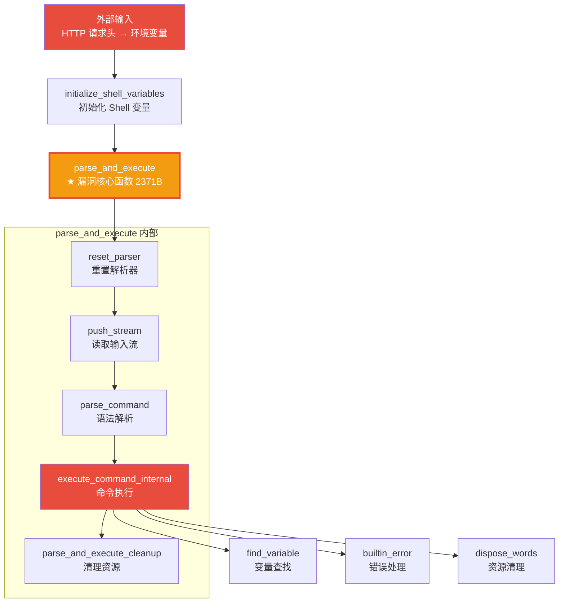
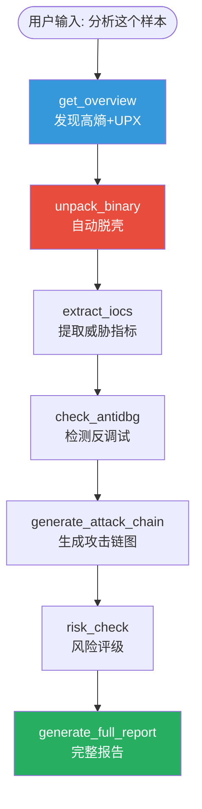

# Reverse-Toolkit：基于 Ghidra 与 LLM 的自动化逆向分析框架

> 从 2210 个函数里自动定位漏洞核心，把枯燥的反编译变成可视化的攻击链分析。


---

## 🎯 这是什么？

Reverse-Toolkit 是一个统一的逆向工程工具包，把 Ghidra 反编译引擎与大语言模型（LLM）结合，实现自动化的二进制分析与漏洞挖掘。

**核心能力：**
- 🤖 **MCP Agent 模式（v5.0）**：15 个工具封装成 MCP Server，AI 自主编排分析流程
- 🧠 **智能降噪**：从几千个函数里精准提炼核心业务函数，过滤库函数噪音
- 📊 **结构化输出**：自动生成 Markdown 体检报告，不是一坨 C 代码
- 🔄 **渐进式分析**：三轮工作流，先看全貌再决定深挖哪里
- 🛡️ **防爆防幻觉**：大文件截断 + AI 分析守则，防止 Token 爆炸和胡编乱造
- 🔽 **优雅降级**：缺 YARA 走 strings 模式，缺 UPX 先分析字符串，环境不完美也能跑
- 🎯 **风险评级**：自动打分低/中/高/严重，附评分依据
- 📈 **攻击链可视化**：自动生成 Mermaid 攻击流程图
- 🧊 **通用脱壳器**：基于 unicorn 引擎模拟执行，突破"只能识别不能脱壳"的边界

---

## 🚀 实战效果：Shellshock 攻击链自动还原



**从 2210 个函数中，自动定位到 Shellshock 漏洞核心函数 `parse_and_execute`，并还原完整攻击链。**

---

## 🤖 AI 自主编排：一句话分析整个样本（v5.0）

**你只需要说一句话：**
> "帮我分析一下这个样本，提取 IOC，评估风险，生成攻击链报告。"

**AI 会自主决策并调用 15 个工具，完成完整分析：**

| 步骤 | AI 决策 | 调用工具 | 输出 |
|------|---------|----------|------|
| 1 | 先快速侦察 | `get_overview` | 发现高熵 7.81 + UPX 特征 |
| 2 | 确认加壳，脱壳 | `unpack_binary` | 自动脱 UPX 壳，返回新路径 |
| 3 | 提取威胁情报 | `extract_iocs` | C2 地址、IP、危险 API 清单 |
| 4 | 检查防御规避 | `check_antidbg` | 检测到反调试 API |
| 5 | 生成攻击链 | `generate_attack_chain` | 自动输出 Mermaid 攻击链图 |
| 6 | 风险评级 | `risk_check` | 🔴 严重（85/100）+ 评分依据 |
| 7 | 完整报告 | `generate_full_report` | 一键输出 Markdown 体检报告 |

**AI 自主调度示例：**



**关键特性：**
- 🧠 **AI 当指挥官**：不用人一步步调工具，大模型自己决定先干嘛后干嘛
- 🔗 **路径自动继承**：脱壳后的新路径自动传给下一个工具，不会断链
- 🛡️ **优雅降级**：缺 YARA 走 strings 模式，缺 UPX 先分析字符串
- 📊 **结构化输出**：所有结果都是 Markdown/IOC JSON，不是一坨日志

---

## 🧊 脱壳能力：从识别到模拟脱壳（v5.0-beta 新升级）

### 三特征交叉验证壳检测

不再单靠字符串匹配，而是三个特征交叉打分，大幅降低误报：

| 特征 | 权重 | 说明 |
|------|------|------|
| 字符串特征 | +3 分 | 检测 UPX!/ASPack/Themida 等特征字符串 |
| 节区名特征 | +3 分 | 检测 .upx0/.vmp 等可疑节区名 |
| 熵值分析 | +3 分（高熵）/+1 分（中熵） | 熵值 >7.0 大概率加壳 |

**置信度分级：**
- 🔴 高置信度（≥6 分）：大概率加壳
- 🟡 中置信度（3-5 分）：可能加壳，建议人工确认
- 🟢 低置信度（<3 分）：大概率未加壳

### 自动脱 UPX 壳

检测到 UPX 特征后，自动调用 `upx -d` 脱壳，备份原文件，输出脱壳后路径。

### 通用脱壳器原型（unicorn 模拟执行）

**突破：不再只能识别壳，而是能模拟执行脱壳！**

```
ELF 解析 → 页对齐内存映射 → 加载 ld.so + libc → 模拟执行 → 监控内存写入 → dump 内存
```

**已实现：**
- ✅ 64 位 ELF 解析 + 程序头表加载
- ✅ unicorn 引擎内存映射（页对齐）
- ✅ 动态链接器 ld.so 加载
- ✅ libc.so.6 加载
- ✅ 栈初始化 + 辅助向量（auxv）
- ✅ 系统调用处理（write/exit/mmap/open/close）
- ✅ 内存写入监控
- ✅ 进程内存 dump

**当前状态：** 原型验证可行，ld.so 可模拟执行 1000+ 条指令。后续将完善动态链接和 OEP 检测，实现真正的通用脱壳。

---

## 📦 功能特性

### 级别一：智能降噪
- 自动过滤 external / thunk / 库函数黑名单（468 个噪音函数）
- 危险 API 三级分级：极高危（执行/网络，权重 10）、高危（文件/注册表，权重 5）、中危（内存操作，权重 2）
- 加权得分排序：`极高危*10 + 高危*5 + 中危*2 + XREF*1`
- callees 递归导出（1 层深度），目标函数 + 子函数一起带出来

### 级别二：结构化输出
- 输出 Markdown 体检报告，大模型一眼抓住重点
- 字符串自动分类：URL / IP / 敏感信息 / 执行相关
- 熵值分析（阈值 7.0，对齐业界标准）
- 大文件截断防爆：每个函数伪代码预览最多 80 行

### 级别三：渐进式分析
| 轮次 | 脚本 | 做什么 |
|-----|------|--------|
| 第一轮 | `overview.sh` | 快速概览：文件指纹 + 熵值 + 壳检测 + 可疑字符串 |
| 第二轮 | `focus_func.sh` | 聚焦深挖：根据可疑点，深挖特定函数 |
| 第三轮 | `analyze.sh` | 完整分析：全局反编译 + 结构化报告 |

### 级别四：外挂扩展
| 模块 | 脚本 | 功能 |
|-----|------|------|
| 脱壳检测 | `unpacker.sh` | 三特征交叉验证 + 置信度评分 + UPX 自动脱壳 |
| 通用脱壳 | `generic_unpacker.py` | unicorn 模拟执行 + 内存 dump |
| YARA 扫描 | `yara_scan.sh` | 内置 UPX / Cobalt Strike / 勒索软件规则 |
| 熵值分析 | `hash_calc.sh` | 判断是否加壳/加密 |
| 反调试检测 | `antidbg_check.sh` | 检测反调试/反虚拟机特征 |
| 更多... | 20+ 专项模块 | 导入表、节区、加密、网络、持久化... |

---

## 🛠️ 快速开始

### 方式一：MCP Agent 模式（v5.0 推荐）

一句话让 AI 自动完成全流程分析，不用手动跑脚本。

**安装依赖：**
```bash
pip install mcp unicorn
```

**配置 Claude Desktop：**

编辑 `claude_desktop_config.json`：
```json
{
  "mcpServers": {
    "reverse-toolkit": {
      "command": "python3",
      "args": ["/你的路径/reverse-toolkit/mcp_server.py"]
    }
  }
}
```

重启 Claude Desktop，看到小锤子图标亮起，直接说：
> 帮我分析这个文件 /tmp/suspicious.bin，看看它是不是恶意的，核心逻辑是什么。

AI 会自主决策：先概览 → 发现加壳 → 自动脱壳 → YARA 扫描 → 深挖函数 → 输出攻击链报告。

**15 个可调用工具：**
| 工具 | 用途 |
|------|------|
| `get_overview` | 快速概览（第一步必用） |
| `quick_check` | 全景检查（含 checksec） |
| `unpack_binary` | 自动脱 UPX 壳 |
| `scan_threats` | YARA 恶意特征扫描 |
| `get_strings` | 字符串分类提取 |
| `check_imports` | 导入表+敏感 API |
| `detect_crypto` | 加密算法识别 |
| `detect_network` | 网络/C2 特征 |
| `check_antidbg` | 反调试检测 |
| `focus_on_function` | 聚焦深挖特定函数 |
| `full_analysis` | 完整 Ghidra 反编译 |
| `generate_full_report` | 一键完整报告（汇总所有检测） |
| `risk_check` | 快速风险评级 |
| `extract_iocs` | IOC 统一提取 |
| `generate_attack_chain` | 攻击链 Mermaid 图 |

---

### 方式二：命令行模式（v4.2）

### 环境要求
- Ghidra 12.2（需要 JDK 25）
- Python 3.8+
- 辅助工具：strings / file / readelf（系统自带）

### 一键分析
```bash
# 快速概览（不跑 Ghidra，10 秒出结果）
bash scripts/overview.sh ./target_binary

# 完整分析（自动选择最佳后端）
bash scripts/analyze.sh ./target_binary ./output_dir

# 聚焦深挖关键词
bash scripts/focus_func.sh ./target_binary "password"

# 脱壳检测（三特征交叉验证）
bash scripts/unpacker.sh ./target_binary

# 通用脱壳器（unicorn 模拟）
python3 scripts/generic_unpacker.py ./target_binary
```

### 输出产物
| 文件 | 内容 |
|-----|------|
| `summary.md` | 结构化体检报告（先看这个） |
| `decompiled/_index.txt` | 函数清单（加权排序，含 [TOP]/[CALLEE] 标记） |
| `decompiled/_dangerous.txt` | 危险函数列表（三级分级） |
| `decompiled/<addr>_<name>.c` | 核心函数完整伪代码 |
| `decompiled/_xref_strings.txt` | 字符串 → 函数交叉引用 |
| `decompiled/_callgraph.txt` | 调用图 |

---

## 📊 压测数据

### /bin/bash (1.4MB) 压测结果

| 指标 | 修复前 | 修复后 | 提升 |
|------|--------|--------|------|
| 总函数数 | 2678 | 2210 | 过滤 468 个库函数 |
| 危险函数数 | 812 | 318 | 降 60% |
| Top 20 内容 | 全是 free/malloc/strlen | 全是 find_variable/builtin_error 等业务函数 | 核心业务上浮 |

### 风险评级误报修复效果

| 样本 | 修复前 | 修复后 | 说明 |
|------|--------|--------|------|
| /bin/ls | 🟠 高危 40/100 | 🟢 低危 0/100 | readelf 方案 + 大小降权 |
| /usr/bin/python3 | 🟠 高危 40/100 | 🟢 低危 18/100 | 大文件权重降权 |
| /usr/bin/ssh | ？ | 🟡 中危 27/100 | 真实风险合理评级 |

---

## 🧠 AI 分析防幻觉守则

读取伪代码时，AI 必须遵守：

1. **[TOP] 标记**：加权得分排序的核心业务函数，优先分析
2. **[CALLEE] 标记**：Top 函数直接调用的子函数
3. **截断标记**：看到 `[代码过长已截断]`，禁止猜测被截断部分的逻辑
4. **反编译失败**：`undefined4` / `halt_baddata()` 是反编译失败特征，不要强行解释
5. **证据优先**：所有结论必须基于实际代码，禁止基于函数名猜测
6. **库函数识别**：malloc/free/strcpy 是标准库，不是核心分析对象

---

## 📁 项目结构

```
reverse-toolkit/
├── SKILL.md                    # 主文档
├── mcp_server.py              # MCP Server v5.0（15 个 AI 工具）
├── install.sh                 # 一键安装 + 环境检测
├── scripts/
│   ├── analyze.sh             # 统一入口 + 环境自检
│   ├── overview.sh            # 第一轮：快速概览
│   ├── focus_func.sh          # 第二轮：聚焦深挖
│   ├── generate_report.py     # 自动报告生成 + 风险评级
│   ├── ExportDecompiled.java  # Ghidra 反编译导出脚本
│   ├── backends/
│   │   ├── ghidra.sh          # Ghidra 后端
│   │   └── r2.sh              # Radare2 后端
│   ├── unpacker.sh            # 脱壳检测（三特征交叉验证）
│   ├── generic_unpacker.py    # 通用脱壳器（unicorn 模拟执行）
│   ├── yara_scan.sh           # YARA 扫描
│   ├── hash_calc.sh           # 哈希 + 熵值
│   ├── strings_extract.sh      # 字符串高级提取
│   ├── imports_exports.sh      # 导入表/导出表
│   ├── sections_analysis.sh    # 节区分析
│   ├── crypto_detect.sh        # 加密算法识别
│   ├── net_detect.sh           # 网络特征检测
│   ├── persist_detect.sh       # 持久化检测
│   ├── antidbg_check.sh       # 反调试检测
│   ├── bin_diff.sh             # 二进制对比
│   ├── make_patch.sh           # 补丁生成
│   ├── debug_info_detect.sh    # 调试信息检测
│   ├── threads_modules.sh      # 线程与模块
│   ├── apk_analyze.sh          # APK 分析
│   ├── firmware_analyze.sh      # 固件分析
│   └── toolbox.sh              # 工具箱
└── README.md
```

---

## ⚠️ 合规声明

**本工具仅用于安全研究和授权测试。**
- 仅分析你有权分析的二进制文件
- 不用于破解付费软件、绕过 DRM/授权、窃取商业机密
- 恶意软件分析仅限防御研究目的
- 使用本工具产生的任何后果由使用者自行承担

---

## 📝 更新日志

### v5.0-beta
- **脱壳能力升级**：三特征交叉验证壳检测（字符串+节区+熵值，9分制置信度评分）
- **通用脱壳器原型**：基于 unicorn 引擎模拟执行，加载 ld.so + libc，内存 dump
- **风险评级误报修复**：改用 readelf 动态符号表 + 文件大小基线降权，大文件误报从 40 分降到 18 分
- **攻击链误报优化**：从单字符串匹配改为多特征交叉验证（需实际 URL/IP、≥2 个执行 API、≥2 个反调试特征）
- **超时优化**：默认超时从 300s 提升到 600s，大文件分析不再超时
- MCP 工具升级到 15 个：新增报告生成、风险评级、IOC 提取、攻击链可视化
- AI 自主编排：一句话完成全流程分析，不用手动调工具
- 一键安装脚本：自动检测环境并安装依赖

### v5.0-alpha
- MCP Server 封装：11 个工具暴露给 AI 自主调用
- Docstring 强警告：防止 AI 乱调工具
- 输出分级截断：6K/8K/10K/15K 按需喂食
- 统一错误前缀：[ERROR]/[TIMEOUT]/[EXCEPTION] 触发 AI 纠错
- 优雅降级：缺依赖自动走手动模式

### v4.2-stable
- 黑名单过滤：external/thunk/_开头库函数/LIB_FUNCTIONS
- 危险 API 三级分级：极高危(10)/高危(5)/中危(2)/基础库(0)
- 加权得分排序：极高危*10 + 高危*5 + 中危*2 + XREF*1
- callees 递归导出：1 层深度，Set 去重
- 大文件截断防爆：每个函数预览 80 行
- AI 防幻觉守则：6 条规则
- 环境自检：入口自动检测依赖

### v4.1
- 优雅降级：Ghidra 超时自动回退概览模式
- YARA 升级：UPX/Cobalt Strike/勒索软件规则
- AI 重命名 Prompt

### v4.0
- 三轮渐进式工作流
- 外挂扩展：脱壳 + YARA
- 结构化 Markdown 报告

---

## 📄 License

MIT License
