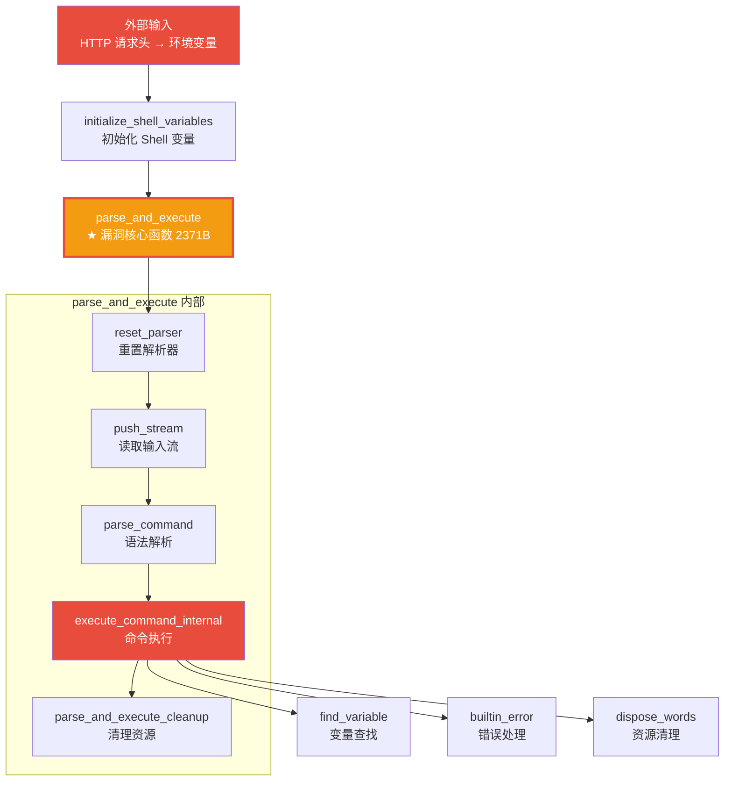

# Reverse-Toolkit：基于 Ghidra 与 LLM 的自动化逆向分析框架

> 从 2210 个函数里自动定位漏洞核心，把枯燥的反编译变成可视化的攻击链分析。


---

## 🎯 这是什么？

Reverse-Toolkit 是一个统一的逆向工程工具包，把 Ghidra 反编译引擎与大语言模型（LLM）结合，实现自动化的二进制分析与漏洞挖掘。

**核心能力：**
- 🧠 **智能降噪**：从几千个函数里精准提炼核心业务函数，过滤库函数噪音
- 📊 **结构化输出**：自动生成 Markdown 体检报告，不是一坨 C 代码
- 🔄 **渐进式分析**：三轮工作流，先看全貌再决定深挖哪里
- 🛡️ **防爆防幻觉**：大文件截断 + AI 分析守则，防止 Token 爆炸和胡编乱造

---

## 🚀 实战效果：Shellshock 攻击链自动还原



**从 2210 个函数中，自动定位到 Shellshock 漏洞核心函数 `parse_and_execute`，并还原完整攻击链。**

---

## 📦 功能特性

### 级别一：智能降噪
- 自动过滤 external / thunk / 库函数黑名单（468 个噪音函数）
- 危险 API 三级分级：极高危（执行/网络，权重 10）、高危（文件/注册表，权重 5）、中危（内存操作，权重 2）
- 加权得分排序：`极高危*10 + 高危*5 + 中危*2 + XREF*1`
- callees 递归导出（1 层深度），目标函数 + 子函数一起带出来

### 级别二：结构化输出
- 输出 Markdown 体检报告，大模型一眼抓住重点
- 字符串自动分类：URL / IP / 敏感信息 / 执行相关
- 熵值分析（阈值 7.0，对齐业界标准）
- 大文件截断防爆：每个函数伪代码预览最多 80 行

### 级别三：渐进式分析
| 轮次 | 脚本 | 做什么 |
|-----|------|--------|
| 第一轮 | `overview.sh` | 快速概览：文件指纹 + 熵值 + 壳检测 + 可疑字符串 |
| 第二轮 | `focus_func.sh` | 聚焦深挖：根据可疑点，深挖特定函数 |
| 第三轮 | `analyze.sh` | 完整分析：全局反编译 + 结构化报告 |

### 级别四：外挂扩展
| 模块 | 脚本 | 功能 |
|-----|------|------|
| 脱壳 | `unpacker.sh` | 自动识别 UPX 壳并脱壳 |
| YARA 扫描 | `yara_scan.sh` | 内置 UPX / Cobalt Strike / 勒索软件规则 |
| 熵值分析 | `hash_calc.sh` | 判断是否加壳/加密 |
| 反调试检测 | `antidbg_check.sh` | 检测反调试/反虚拟机特征 |
| 更多... | 20+ 专项模块 | 导入表、节区、加密、网络、持久化... |

---

## 🛠️ 快速开始

### 环境要求
- Ghidra 12.2（需要 JDK 25）
- Python 3.8+
- 辅助工具：strings / file / readelf（系统自带）

### 一键分析
```bash
# 快速概览（不跑 Ghidra，10 秒出结果）
bash scripts/overview.sh ./target_binary

# 完整分析（自动选择最佳后端）
bash scripts/analyze.sh ./target_binary ./output_dir

# 聚焦深挖关键词
bash scripts/focus_func.sh ./target_binary "password"
```

### 输出产物
| 文件 | 内容 |
|-----|------|
| `summary.md` | 结构化体检报告（先看这个） |
| `decompiled/_index.txt` | 函数清单（加权排序，含 [TOP]/[CALLEE] 标记） |
| `decompiled/_dangerous.txt` | 危险函数列表（三级分级） |
| `decompiled/<addr>_<name>.c` | 核心函数完整伪代码 |
| `decompiled/_xref_strings.txt` | 字符串 → 函数交叉引用 |
| `decompiled/_callgraph.txt` | 调用图 |

---

## 📊 压测数据

### /bin/bash (1.4MB) 压测结果

| 指标 | 修复前 | 修复后 | 提升 |
|------|--------|--------|------|
| 总函数数 | 2678 | 2210 | 过滤 468 个库函数 |
| 危险函数数 | 812 | 318 | 降 60% |
| Top 20 内容 | 全是 free/malloc/strlen | 全是 find_variable/builtin_error 等业务函数 | 核心业务上浮 |

---

## 🧠 AI 分析防幻觉守则

读取伪代码时，AI 必须遵守：

1. **[TOP] 标记**：加权得分排序的核心业务函数，优先分析
2. **[CALLEE] 标记**：Top 函数直接调用的子函数
3. **截断标记**：看到 `[代码过长已截断]`，禁止猜测被截断部分的逻辑
4. **反编译失败**：`undefined4` / `halt_baddata()` 是反编译失败特征，不要强行解释
5. **证据优先**：所有结论必须基于实际代码，禁止基于函数名猜测
6. **库函数识别**：malloc/free/strcpy 是标准库，不是核心分析对象

---

## 📁 项目结构

```
reverse-toolkit/
├── SKILL.md                    # 主文档
├── scripts/
│   ├── analyze.sh             # 统一入口 + 环境自检
│   ├── overview.sh            # 第一轮：快速概览
│   ├── focus_func.sh          # 第二轮：聚焦深挖
│   ├── ExportDecompiled.java  # Ghidra 反编译导出脚本
│   ├── backends/
│   │   ├── ghidra.sh          # Ghidra 后端
│   │   └── r2.sh              # Radare2 后端
│   ├── unpacker.sh            # 脱壳分析
│   ├── yara_scan.sh           # YARA 扫描
│   ├── hash_calc.sh           # 哈希 + 熵值
│   ├── strings_extract.sh      # 字符串高级提取
│   ├── imports_exports.sh      # 导入表/导出表
│   ├── sections_analysis.sh    # 节区分析
│   ├── crypto_detect.sh        # 加密算法识别
│   ├── net_detect.sh           # 网络特征检测
│   ├── persist_detect.sh       # 持久化检测
│   ├── antidbg_check.sh       # 反调试检测
│   ├── bin_diff.sh             # 二进制对比
│   ├── make_patch.sh           # 补丁生成
│   ├── debug_info_detect.sh    # 调试信息检测
│   ├── threads_modules.sh      # 线程与模块
│   ├── apk_analyze.sh          # APK 分析
│   ├── firmware_analyze.sh      # 固件分析
│   └── toolbox.sh              # 工具箱
└── README.md
```

---

## ⚠️ 合规声明

**本工具仅用于安全研究和授权测试。**
- 仅分析你有权分析的二进制文件
- 不用于破解付费软件、绕过 DRM/授权、窃取商业机密
- 恶意软件分析仅限防御研究目的
- 使用本工具产生的任何后果由使用者自行承担

---

## 📝 更新日志

### v4.2-stable
- 黑名单过滤：external/thunk/_开头库函数/LIB_FUNCTIONS
- 危险 API 三级分级：极高危(10)/高危(5)/中危(2)/基础库(0)
- 加权得分排序：极高危*10 + 高危*5 + 中危*2 + XREF*1
- callees 递归导出：1 层深度，Set 去重
- 大文件截断防爆：每个函数预览 80 行
- AI 防幻觉守则：6 条规则
- 环境自检：入口自动检测依赖

### v4.1
- 优雅降级：Ghidra 超时自动回退概览模式
- YARA 升级：UPX/Cobalt Strike/勒索软件规则
- AI 重命名 Prompt

### v4.0
- 三轮渐进式工作流
- 外挂扩展：脱壳 + YARA
- 结构化 Markdown 报告

---

## 📄 License

MIT License