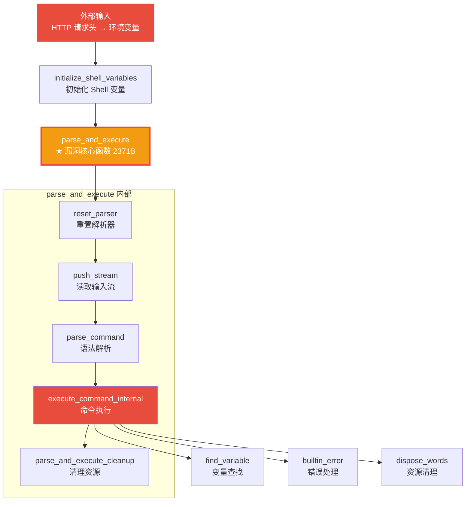
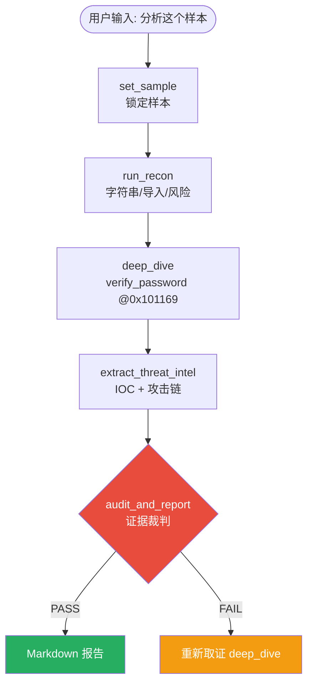

# Reverse-Toolkit：基于 Ghidra 与 LLM 的自动化逆向分析框架

> 从 2210 个函数里自动定位漏洞核心，把枯燥的反编译变成可视化的攻击链分析。


---

## 🎯 这是什么？

Reverse-Toolkit 是一个统一的逆向工程工具包，把 Ghidra 反编译引擎与大语言模型（LLM）结合，实现自动化的二进制分析与漏洞挖掘。

**核心能力：**
- 🤖 **MCP Agent 模式（v5.1）**：5 个超级原语封装成 MCP Server，AI 自主编排分析流程
- 🔍 **证据可回溯**：每条结论强制携带 `[Evidence: 地址] 符号`，杜绝"函数名像、结论就成立"
- 🛡️ **Critic Mode 证据裁判**：`audit_and_report` 逐条校验，幻觉直接 FAIL、禁止出报告
- 🧠 **智能降噪**：从几千个函数里精准提炼核心业务函数，过滤库函数噪音
- 📊 **结构化输出**：自动生成 Markdown 体检报告，不是一坨 C 代码
- 🔄 **渐进式分析**：三轮工作流，先看全貌再决定深挖哪里
- 🛡️ **防爆防幻觉**：大文件截断 + AI 分析守则，防止 Token 爆炸和胡编乱造
- 🔽 **优雅降级**：缺 YARA 走 strings 模式，缺 UPX 先分析字符串，环境不完美也能跑
- 🎯 **风险评级**：自动打分低/中/高/严重，附评分依据
- 📈 **攻击链可视化**：自动生成 Mermaid 攻击流程图
- 🧊 **通用脱壳器**：基于 unicorn 引擎模拟执行，突破"只能识别不能脱壳"的边界

---

## 🚀 实战效果：Shellshock 攻击链自动还原



**从 2210 个函数中，自动定位到 Shellshock 漏洞核心函数 `parse_and_execute`，并还原完整攻击链。**

---

## 🤖 AI 自主编排：5 个原语 + 证据裁判（v5.1）

**你只需要说一句话：**
> "帮我分析一下这个样本，提取 IOC，评估风险，生成攻击链报告。"

**AI 只用 5 个原语，每一步都留下证据：**

| 步骤 | 调用原语 | 输出（节选） |
|------|---------|-------------|
| 1 | `set_sample(path)` | 锁定样本 + 文件指纹，重置证据台账 |
| 2 | `run_recon()` | `[Evidence: 0x1976a] .rodata: https://...` + 风险评级 |
| 3 | `deep_dive("verify_password")` | `[Evidence: 0x101169] verify_password` + 伪代码 |
| 4 | `extract_threat_intel()` | IOC 表 + Mermaid 攻击链（每条带地址） |
| 5 | `audit_and_report(claims)` | 证据裁判 PASS 才输出 Markdown 报告 |

**为什么做减法：** 工具超过 20 个，模型选错工具的概率显著上升。v5.1 把 17 个工具合并成 5 个"完整业务原语"，
每个原语返回可直接引用的证据块；跨工具状态断裂也一并消失（脱壳自动切换 `active_path`，AI 甚至不用知道路径变了）。

**AI 自主调度示例：**



**真实裁判输出（幻觉当场拦住，FAIL 不落盘）：**

```text
[AUDIT_RESULT: FAIL] 证据链断裂，禁止输出报告。
违规 2 条：
- C9 AE-2: 引用 `0xdeadbeef` 不在证据台账（疑似幻觉地址/编号）
- C9 AE-3: 正文地址 0xdeadbeef 从未在证据台账中出现
```

**关键特性：**
- 🧠 **工具做减法**：17 → 5，优先保证 Tool Call 准确率
- 🔍 **证据做加法**：所有结论强制携带 `[Evidence: 地址] 符号`，可按 EV 编号回溯
- 🛡️ **红队裁判**：AE-1~AE-8 八条规则，幻觉 FAIL、弱证据自动降级"待核实"
- 🔗 **路径自动继承**：脱壳后活跃路径自动切换，不会断链

---

## 📦 功能特性

### 级别一：智能降噪
- 自动过滤 external / thunk / 库函数黑名单（468 个噪音函数）
- 危险 API 三级分级：极高危（执行/网络，权重 10）、高危（文件/注册表，权重 5）、中危（内存操作，权重 2）
- 加权得分排序：`极高危*10 + 高危*5 + 中危*2 + XREF*1`
- callees 递归导出（1 层深度），目标函数 + 子函数一起带出来

### 级别二：结构化输出
- 输出 Markdown 体检报告，大模型一眼抓住重点
- 字符串自动分类：URL / IP / 敏感信息 / 执行相关
- 熵值分析（阈值 7.0，对齐业界标准）
- 大文件截断防爆：每个函数伪代码预览最多 80 行

### 级别三：渐进式分析
| 轮次 | 脚本 | 做什么 |
|-----|------|--------|
| 第一轮 | `overview.sh` | 快速概览：文件指纹 + 熵值 + 壳检测 + 可疑字符串 |
| 第二轮 | `focus_func.sh` | 聚焦深挖：根据可疑点，深挖特定函数 |
| 第三轮 | `analyze.sh` | 完整分析：全局反编译 + 结构化报告 |

### 级别四：外挂扩展
| 模块 | 脚本 | 功能 |
|-----|------|------|
| 脱壳 | `unpacker.sh` | 三特征交叉验证 + UPX 自动脱壳 + JSON 结构化输出 |
| 通用脱壳 | `generic_unpacker.py` | unicorn 模拟执行 + 内存 dump |
| YARA 扫描 | `yara_scan.sh` | 内置 UPX / Cobalt Strike / 勒索软件规则 |
| 熵值分析 | `hash_calc.sh` | 判断是否加壳/加密 |
| 反调试检测 | `antidbg_check.sh` | 检测反调试/反虚拟机特征 |
| 更多... | 20+ 专项模块 | 导入表、节区、加密、网络、持久化... |

---

## 🛠️ 快速开始

### 方式一：MCP Agent 模式（v5.1 推荐）

一句话让 AI 自动完成全流程分析，不用手动跑脚本。

**安装依赖：**
```bash
pip install -r requirements.txt
```

**配置 Claude Desktop：**

编辑 `claude_desktop_config.json`：
```json
{
  "mcpServers": {
    "reverse-toolkit": {
      "command": "python3",
      "args": ["/你的路径/reverse-toolkit/mcp_server.py"]
    }
  }
}
```

重启 Claude Desktop，看到小锤子图标亮起，直接说：
> 帮我分析这个文件 /tmp/suspicious.bin，看看它是不是恶意的，核心逻辑是什么。

AI 会自主决策：锁定样本 → 综合体检 → 按可疑点深挖函数 → 抽取威胁情报 → **调用证据裁判自查**，PASS 才输出报告。任何一条结论没有 `[Evidence]` 支撑，裁判会直接拦下。

**5 个可调用原语（v5.1）：**
| 原语 | 用途 | 合并了旧版 |
|------|------|-----------|
| `set_sample` | 锁定样本 + 重置证据台账 | set_sample / get_context |
| `run_recon` | 概览 + 字符串 + 导入 + YARA + 风险评级 | get_overview / quick_check / get_strings / check_imports / detect_crypto / detect_network / scan_threats / risk_check |
| `deep_dive` | 目标函数深挖（自动脱壳 + FOCUS 强制导出 + 截断） | unpack_binary / focus_on_function / full_analysis / generate_full_report |
| `extract_threat_intel` | IOC + YARA + 攻击链 | extract_iocs / generate_attack_chain / check_antidbg |
| `audit_and_report` | Critic Mode 证据审计 + Markdown 报告 | 新增 |

> ⚠️ **v5.1 是破坏性升级，不保留旧工具别名。** 如果 prompt / 文档里写过旧工具名，按上表映射替换即可。

---

### 方式二：Docker 一键部署

```bash
docker build -t reverse-toolkit .
docker run -it reverse-toolkit
```

---

### 方式三：命令行模式

### 环境要求
- Ghidra 12.2（需要 JDK 25）
- Python 3.8+
- 辅助工具：strings / file / readelf（系统自带）

### 一键分析
```bash
# 快速概览（不跑 Ghidra，10 秒出结果）
bash scripts/overview.sh ./target_binary

# 完整分析（自动选择最佳后端）
bash scripts/analyze.sh ./target_binary ./output_dir

# 聚焦深挖关键词
bash scripts/focus_func.sh ./target_binary "password"

# 脱壳检测（三特征交叉验证）
bash scripts/unpacker.sh ./target_binary
```

---

## 📊 压测数据

### /bin/bash (1.4MB) 压测结果

| 指标 | 修复前 | 修复后 | 提升 |
|------|--------|--------|------|
| 总函数数 | 2678 | 2210 | 过滤 468 个库函数 |
| 危险函数数 | 812 | 318 | 降 60% |
| Top 20 内容 | 全是 free/malloc/strlen | 全是 find_variable/builtin_error 等业务函数 | 核心业务上浮 |

### 风险评级误报修复效果

| 样本 | 修复前 | 修复后 | 说明 |
|------|--------|--------|------|
| /bin/ls | 🟠 高危 40/100 | 🟢 低危 0/100 | readelf 方案 + 大小降权 |
| /usr/bin/python3 | 🟠 高危 40/100 | 🟢 低危 18/100 | 大文件权重降权 |

---

## ✅ 工程化

- **14 个单元测试**：`python test_core.py` 一键跑通（含"工具数必须是 5"、"伪造地址/伪造符号必须 FAIL"）
- **证据台账**：所有结论带 `[Evidence: 地址] 符号`，可按 EV 编号回溯
- **单文件降噪脚本**：`scripts/ExportDecompiled.java` 可独立配合任意 Ghidra MCP 框架（[说明](docs/ExportDecompiled-standalone.md)）
- **GitHub Actions CI**：每次 push 自动跑测试
- **Dockerfile**：一键容器化部署
- **全局状态管理**：AI 不用记路径，工具自动接力

---

## 🧠 AI 分析防幻觉守则

读取伪代码时，AI 必须遵守：

1. **[TOP] 标记**：加权得分排序的核心业务函数，优先分析
2. **[CALLEE] 标记**：Top 函数直接调用的子函数
3. **截断标记**：看到 `[代码过长已截断]`，禁止猜测被截断部分的逻辑
4. **反编译失败**：`undefined4` / `halt_baddata()` 是反编译失败特征，不要强行解释
5. **证据优先**：所有结论必须基于实际代码，禁止基于函数名猜测
6. **库函数识别**：malloc/free/strcpy 是标准库，不是核心分析对象

**v5.1 追加三条硬约束：**

7. **证据标签**：结论必须引用返回结果里的 `[Evidence: 地址] 符号`，没有证据就写"未找到"
8. **出报告前必须自查**：`audit_and_report` 返回 FAIL 时，禁止输出任何报告，先补证据
9. **裁判只判匹配**：AE-1~AE-8 校验的是"声明与证据是否对得上"，不评价你的分析水平

---

## ⚠️ 合规声明

**本工具仅用于安全研究和授权测试。**
- 仅分析你有权分析的二进制文件
- 不用于破解付费软件、绕过 DRM/授权、窃取商业机密
- 恶意软件分析仅限防御研究目的
- 使用本工具产生的任何后果由使用者自行承担

---

## 📝 更新日志

### v5.1-stable
- **工具做减法**：17 → 5 个超级原语（set_sample / run_recon / deep_dive / extract_threat_intel / audit_and_report），不保留旧别名
- **证据台账**：所有输出强制 `[Evidence: 地址] 符号`，字符串映射到真实 VA，非装载节如实降级 `file+0x...`
- **Critic Mode**：8 条 audit_evidence 规则（AE-1~AE-8），幻觉 FAIL 且不落盘报告，弱证据 WARN 降级"待核实"
- **FOCUS 强制导出**：ExportDecompiled.java 新增第 3 参数，目标函数不在 Top N 也导出
- **SKILL.md 同步**：要求 AI 输出最终报告前必须调用 audit_and_report

### v5.0-stable
- **全局状态黑板**：set_sample / get_context 工具，AI 不用记路径
- **JSON 结构化通讯**：shell 脚本输出标准 JSON，Python 层自动解析
- **脱壳自动接力**：脱壳成功后，活跃路径自动切换
- **工程化完善**：8 个单元测试 + GitHub Actions CI + Dockerfile
- MCP 工具升级到 17 个

### v5.0-beta
- **脱壳能力升级**：三特征交叉验证壳检测（字符串+节区+熵值，9分制置信度评分）
- **通用脱壳器原型**：基于 unicorn 引擎模拟执行，加载 ld.so + libc，内存 dump
- **风险评级误报修复**：改用 readelf 动态符号表 + 文件大小基线降权
- **攻击链误报优化**：从单字符串匹配改为多特征交叉验证
- **超时优化**：默认超时从 300s 提升到 600s
- MCP 工具升级到 15 个：新增报告生成、风险评级、IOC 提取、攻击链可视化

### v5.0-alpha
- MCP Server 封装：11 个工具暴露给 AI 自主调用
- Docstring 强警告：防止 AI 乱调工具
- 输出分级截断：6K/8K/10K/15K 按需喂食
- 统一错误前缀：[ERROR]/[TIMEOUT]/[EXCEPTION] 触发 AI 纠错
- 优雅降级：缺依赖自动走手动模式

### v4.2-stable
- 黑名单过滤：external/thunk/_开头库函数/LIB_FUNCTIONS
- 危险 API 三级分级：极高危(10)/高危(5)/中危(2)/基础库(0)
- 加权得分排序：极高危*10 + 高危*5 + 中危*2 + XREF*1
- callees 递归导出：1 层深度，Set 去重
- 大文件截断防爆：每个函数预览 80 行
- AI 防幻觉守则：6 条规则
- 环境自检：入口自动检测依赖

---

## 📄 License

MIT License
